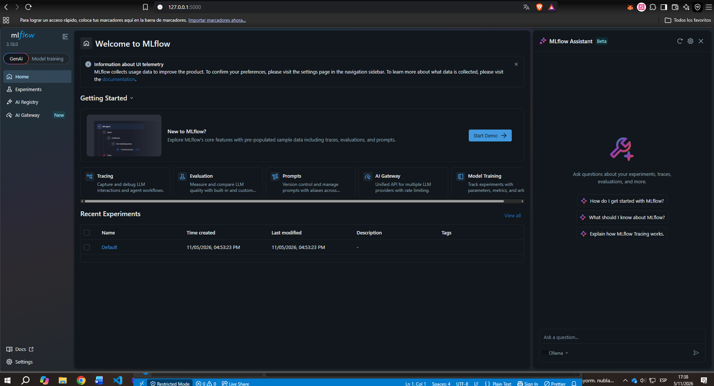

# Pipeline de ML reproducible · NOMBRE DEL PROYECTO

Machine Learning I · Proyecto Integrador · Entregable individual
Alumno(a): NOMBRE · Grupo: N · Algoritmo asignado: MODELO

**Resumen:** QUÉ predice el modelo, con QUÉ dataset peruano (fuente) y cuántas filas.

## Cómo reproducir
Probado con **Python X.Y.Z** en SISTEMA OPERATIVO.

macOS / Linux:
```bash
git clone URL_DEL_REPOSITORIO repro && cd repro
python -m venv .venv && source .venv/bin/activate
pip install -r requirements.txt
PYTHONHASHSEED=0 python -m src.prepare_data
PYTHONHASHSEED=0 python -m src.train --seed 42
PYTHONHASHSEED=0 python -m src.run_seeds
```
Windows (PowerShell):
```powershell
git clone URL_DEL_REPOSITORIO repro; cd repro
python -m venv .venv; .venv\Scripts\Activate.ps1
pip install -r requirements.txt
$env:PYTHONHASHSEED=0
python -m src.prepare_data
python -m src.train --seed 42
python -m src.run_seeds
```

## Resultado esperado
Una corrida (`--seed 42`):
```
PEGAR AQUÍ LA SALIDA JSON
```
Cinco semillas (`results/results_summary.csv`): PEGAR LA TABLA.

**Resultado reportado:** MÉTRICA = media ± DE entre 5 semillas (baseline: …).



## Estructura de datos (data lake)
| Zona | Carpeta | Contenido | Regla |
|---|---|---|---|
| raw (bronze) | `data/raw/` | Archivo original | Nunca se edita |
| processed (silver) | `data/processed/` | Datos limpios | Se regenera con `src.prepare_data` |
| results (gold) | `results/` | Métricas | Se regenera con `src.run_seeds` |

Ver `data/MANIFIESTO.md`.

## Qué lo hace reproducible
| Requisito | Cómo se cumple |
|---|---|
| ≥ 6 commits | |
| Sin fuga de datos | |
| Aleatoriedad fija | |
| 5 semillas en MLflow, media ± DE | |
| Mismos datos para todos | |
| Entorno exacto | |

## Prueba del extraño
Quién la hizo (nombre y grupo), enlace al Issue y resultado.

## Limitaciones

## Respuestas
1. …
2. …
3. …
4. …
5. …
6. …

## Declaración de uso de IA
Qué herramienta de IA se usó, para qué y qué revisó o ejecutó el autor. Si no se usó, indicarlo.
