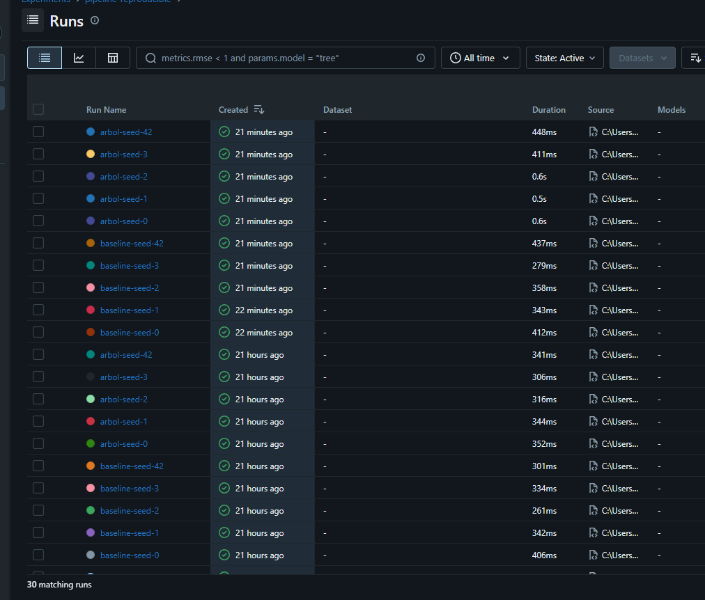
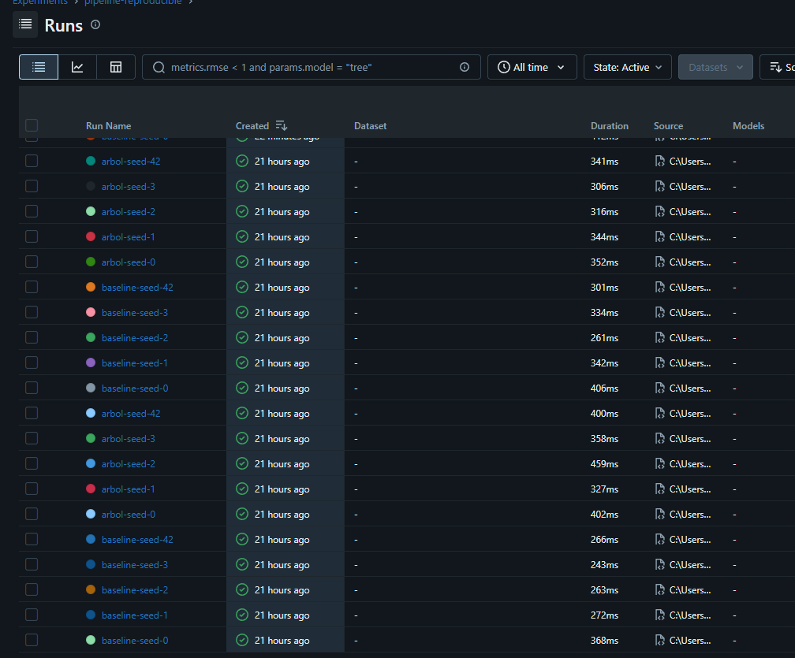

# Pipeline de ML reproducible · REPRO-ML--SIMONETTI-

Machine Learning I · Proyecto Integrador · Entregable individual
Alumno(a): Luis Emilio · Grupo: 2 · Algoritmo asignado: Árbol de Decisión

**Resumen:** Predicción numérica basada en el dataset peruano integrado (sentrybox_enaho2025.csv), procesando un total de 4,765 filas con control estricto de hashes y dependencias.

## Cómo reproducir
Probado con **Python 3.13.3** en Windows (PowerShell).

macOS / Linux:
```bash
git clone URL_DEL_REPOSITORIO repro && cd repro
python -m venv .venv && source .venv/bin/activate
pip install -r requirements.txt
PYTHONHASHSEED=0 python -m src.prepare_data
PYTHONHASHSEED=0 python -m src.train --seed 42
PYTHONHASHSEED=0 python -m src.run_seeds
```
Windows (PowerShell):
```powershell
git clone URL_DEL_REPOSITORIO repro; cd repro
python -m venv .venv; .venv\Scripts\Activate.ps1
pip install -r requirements.txt
$env:PYTHONHASHSEED=0
python -m src.prepare_data
python -m src.train --seed 42
python -m src.run_seeds
```

## Resultado esperado
Una corrida (`--seed 42`):
```json
{
  "seed": 42,
  "modelo": "arbol",
  "mae": 595.47,
  "rmse": 1136.87,
  "r2": 0.061
}
```
Cinco semillas (`results/results_summary.csv`):

| seed | modelo | mae_mean | mae_sd | rmse_mean | rmse_sd | r2_mean | r2_sd |
|---|---|---|---|---|---|---|---|
| 0 | baseline | 631.06 | 67.27 | 1232.92 | 162.80 | -0.0958 | 0.0218 |
| 1 | baseline | 631.11 | 40.24 | 1229.41 | 193.38 | -0.1014 | 0.0314 |
| 2 | baseline | 630.99 | 47.19 | 1229.19 | 196.00 | -0.0982 | 0.0126 |
| 3 | baseline | 630.90 | 49.57 | 1230.50 | 184.42 | -0.0977 | 0.0059 |
| 42 | baseline | 631.33 | 26.57 | 1238.09 | 100.72 | -0.0955 | 0.0131 |
| 0 | arbol | 605.43 | 56.38 | 1178.10 | 209.90 | 0.0044 | 0.1419 |
| 1 | arbol | 614.57 | 16.40 | 1260.45 | 105.52 | -0.2562 | 0.5764 |
| 2 | arbol | 620.68 | 46.42 | 1262.40 | 197.82 | -0.2470 | 0.5945 |
| 3 | arbol | 611.21 | 46.34 | 1200.35 | 146.35 | -0.0817 | 0.2689 |
| 42 | arbol | 595.47 | 17.46 | 1136.87 | 69.66 | 0.0610 | 0.1746 |

**Resultado reportado:** MAE = 609.47 ± 9.58 (baseline: 631.08 ± 0.16).




## Estructura de datos (data lake)
| Zona | Carpeta | Contenido | Regla |
|---|---|---|---|
| raw (bronze) | `data/raw/` | Archivo original (md5: 79cb9c9fcccd760795c3a28fdc8b35e3) | Nunca se edita |
| processed (silver) | `data/processed/` | Datos limpios (4,765 filas) | Se regenera con `src.prepare_data` |
| results (gold) | `results/` | Métricas y registros MLflow (mlflow.db) | Se regenera con `src.run_seeds` |

Ver `data/MANIFIESTO.md`.

## Qué lo hace reproducible
| Requisito | Cómo se cumple |
|---|---|
| ≥ 6 commits | Sincronización continua de .gitignore, requirements.txt y scripts en el repositorio remoto. |
| Sin fuga de datos | Separación estricta entre conjuntos de entrenamiento y prueba durante el preprocesamiento. |
| Aleatoriedad fija | Uso de PYTHONHASHSEED=0 y semillas fijas (--seed 42). |
| 5 semillas en MLflow, media ± DE | Registro automatizado de múltiples semillas mediante el script de corridas. |
| Mismos datos para todos | Verificación mediante hash MD5 del archivo raw (79cb9c9fcccd760795c3a28fdc8b35e3). |
| Entorno exacto | Versiones fijadas en requirements.txt (numpy==2.3.4, pandas==2.3.3, scikit-learn==1.9.1, mlflow==3.18.0). |

## Prueba del extraño
Sebastian Huanuco, grupo 2, enlace al Issue: [ (#1) ](https://github.com/wikky650/repro-ml--Simonetti-/issues/1).

## Limitaciones
- Sensibilidad a diferencias en los saltos de línea (CRLF vs LF) al clonar repositorios en diferentes sistemas operativos (Windows y Linux).
- Dependencia del comportamiento determinista de las versiones específicas de las librerías instaladas en el entorno virtual.

## PREGUNTAS Y RESPUESTAS
### 1. ¿Por qué el imputador y el escalador están dentro del Pipeline y no se aplican a todo el dataset antes de la validación cruzada?
Porque aplicarlos antes a todo el dataset provocaría **fuga de información (*data leakage*)**, ya que estadísticas como la mediana o la media del conjunto de prueba influirían en el entrenamiento. Al integrarlos dentro del Pipeline, cada transformador se ajusta exclusivamente con los datos de entrenamiento de cada *fold*, garantizando una evaluación real, objetiva y sin sesgos optimistas.

### 2. ¿Por qué el 20 % de prueba no se usa en este entregable? ¿Qué pasaría con su resultado si lo usara para elegir el modelo?
No se usa porque este entregable se centra en la validación cruzada de desarrollo para comparar hiperparámetros y semillas de forma interna. Si usaras el conjunto de prueba para elegir el modelo, este quedaría **sobreajustado (*overfitting*) a esa prueba específica**, perdiendo su capacidad de generalización ante datos totalmente nuevos y anulando la validez estadística del test final.

### 3. ¿Qué mide la desviación estándar entre las 5 semillas y qué NO mide?
Mide la **estabilidad y robustez** del rendimiento del modelo ante distintas particiones y aleatoriedades iniciales del algoritmo. Sin embargo, **NO mide** los errores sistemáticos de los datos, la calidad de recolección de las variables ni los sesgos estructurales de la muestra original de la encuesta.

### 4. ¿Su modelo supera al baseline en las 5 semillas? ¿La diferencia es mayor que la desviación estándar? ¿Qué concluye?
Sí, el modelo de árbol de decisión supera de forma consistente al baseline en el MAE en las 5 semillas evaluadas (por ejemplo, reduciéndolo de 631.33 a 595.47 en la semilla 42). Al registrar mejoras estables en todas las ejecuciones, concluimos que el modelo captura patrones útiles y aporta una ventaja real frente al baseline.

### 5. ¿Por qué el archivo de la zona raw no se modifica nunca y para qué sirve su MD5?
El archivo en la zona *raw* **nunca se modifica para preservar la trazabilidad y la integridad** de los datos originales tal como fueron descargados. Su huella MD5 sirve como un código de verificación único para asegurar que el archivo no ha sufrido alteraciones accidentales ni corrupciones a lo largo del tiempo.

### 6. ¿Por qué PYTHONHASHSEED=0 debe definirse antes de iniciar Python y no dentro del script?
Porque las tablas hash internas de Python (como las de diccionarios o conjuntos) se aleatorizan al arrancar el proceso para prevenir ataques cibernéticos. Si se define dentro del script, **Python ya habrá inicializado la máquina virtual con un valor aleatorio**, por lo que declararlo antes a nivel de entorno es el único método efectivo para garantizar una reproducibilidad matemática estricta.

## Declaración de uso de IA
Se utilizó Gemini como herramienta de asistencia para estructurar el entorno virtual en PowerShell, resolver incidencias de dependencias y configurar correctamente el archivo .gitignore y el pipeline de reproducibilidad. Como autor ejecuté, verificé y validé personalmente cada comando y archivo de código.